# Periodicity

An interactive atlas of all 118 chemical elements, rebuilt with **Bun, SvelteKit 3, Svelte 5, and TypeScript**.

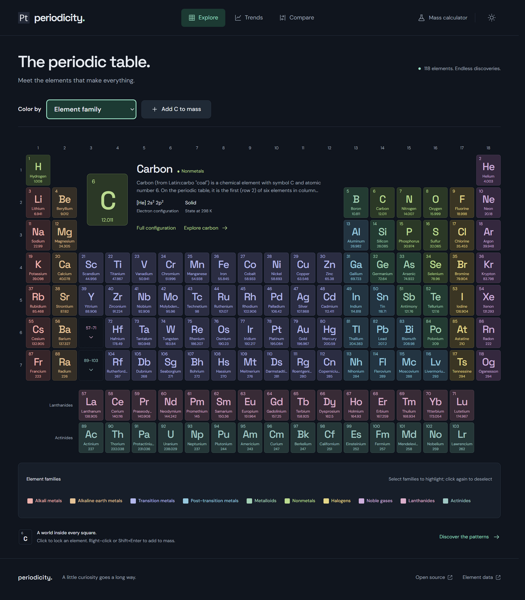

Explore the periodic table, follow six periodic trends, compare up to four elements, and calculate molecular mass from a chemical formula.

## Run locally

Requires Bun 1.4.2 or newer. Dependencies and variable fonts are served locally; the application does not need external data requests.

```sh
bun install --frozen-lockfile
bun run dev
```

Open the local URL printed by Vite (normally `http://localhost:5173`).

```sh
bun run check       # Svelte and strict TypeScript diagnostics
bun test            # Data, URL state, keyboard navigation, and chemistry
bun run data:check  # Verify the committed runtime data matches its sources
bun run build       # Prerender the application and all 118 element pages
bun run preview     # Serve the production build locally
bun run format      # Format the source and documentation
bun run format:check
```

Browser regressions run against the production build. Install Chromium once, including system libraries on Linux, then run:

```sh
bunx playwright install --with-deps chromium
bun run build
bun run test:e2e
```

The Playwright suite starts a local preview server and covers URL initialization, consecutive updates, search aliases, comparison limits, focus restoration, mobile keyboard navigation, and saved appearance.

## Explore

### Periodic table

Explore all 118 elements, highlight one or more families, and select a tile to inspect its atomic mass, electron configuration, and physical state. Use **Color by** to switch between family colors, physical states, and property heatmaps; the example below maps electronegativity with fluorine selected.

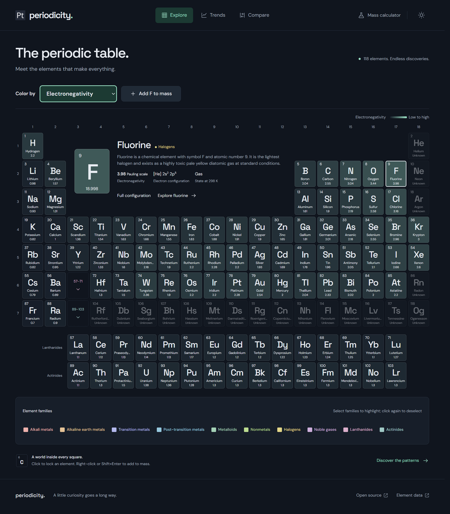

### Full electron configuration

Select **Full configuration** in an element preview to expand its noble-gas core without leaving the table. Switch between **Short**, **Full**, and **By shell**, or copy the current view as plain text; the screenshot shows iron’s electrons grouped by principal shell. Close with Escape, **Close**, or the backdrop to return focus to the entry button.

The element page uses the same viewer, defaults to Full, and preserves the view when browsing neighboring elements. Share a shell view with `/element/26/?configuration=shell#electronic-heading`.

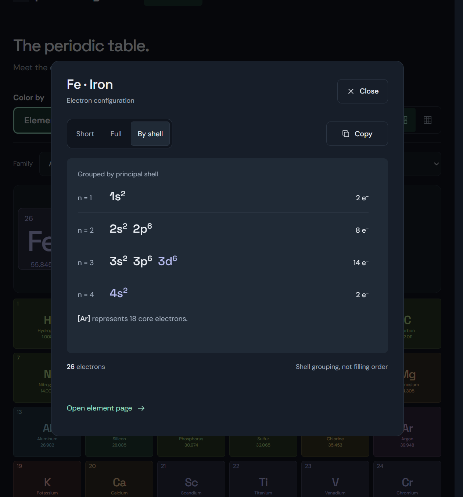

### Quick molar mass

Build a formula directly on the periodic table: right-click tiles or focus a tile and press Shift+Enter to add atoms. On touch screens, select an element and use **Add [symbol] to mass**. Repeated elements become subscripts, and the preview shows each atomic mass and the total; adding two hydrogen atoms and one oxygen atom gives `H2O`, at **18.015 g/mol**.

**Undo** removes the last atom; **Close** or Escape clears the calculation. Open **Full calculator** to see the composition and mass percentages.

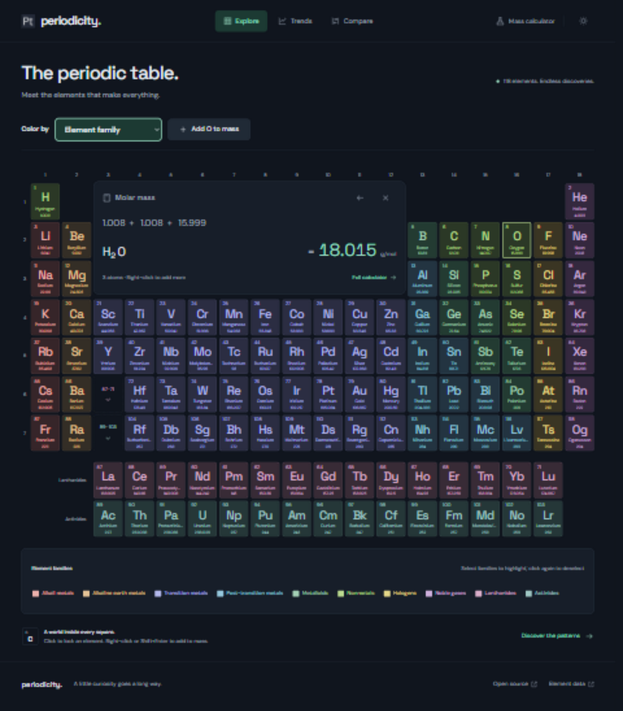

### Temperature and physical states

Choose **Physical state** in the **Color by** menu, then adjust the slider or enter a temperature from **0–6,000 K**. The table updates its colors and solid, liquid, gas, and unknown counts; the example shows the estimated states at **1,000 K**.

These states are educational approximations at ordinary pressure. Missing measurements remain unknown, and transitions without a liquid interval are handled separately. Desktop controls keep their layout space when hidden; small windows collapse it to keep the grid close to the toolbar.

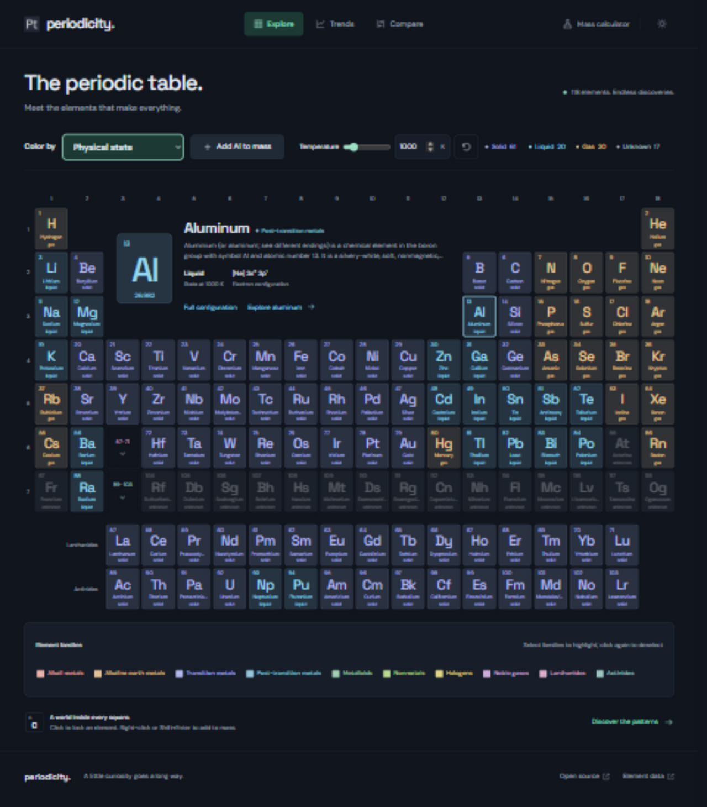

### Periodic trends

Follow six properties: ionization energy, electronegativity, atomic radius, electron affinity, density, and melting point. Filter by period and inspect exact values on the interactive chart, or switch to **Data** for a sortable, searchable, paginated table. Missing measurements appear as gaps or unavailable values, rather than zeroes.

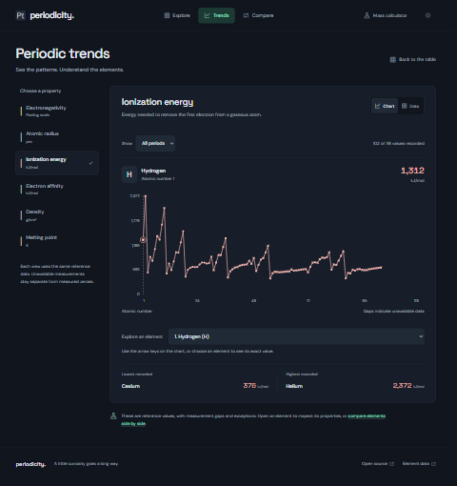

<details>
<summary>Data view: electronegativity in period 3</summary>

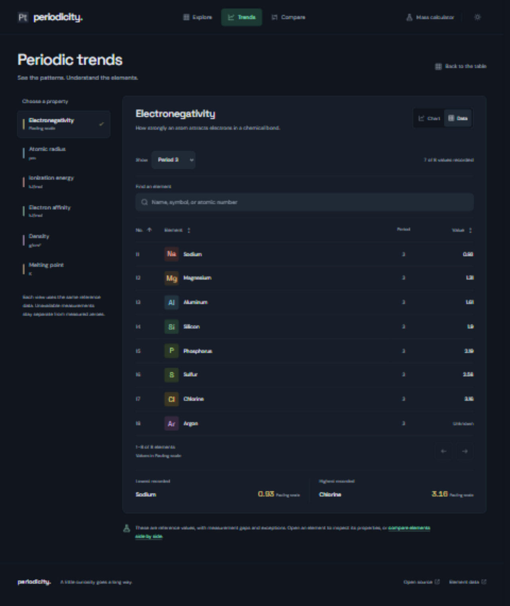

</details>

### Element pages

Open an element’s page to read its original summary, discovery information, and physical properties. Inspect an illustrative electron-shell model, expand the electron configuration, and see the element’s position on a periodic trend chart. Neighbor links let you continue through the table; the example below explores iron.

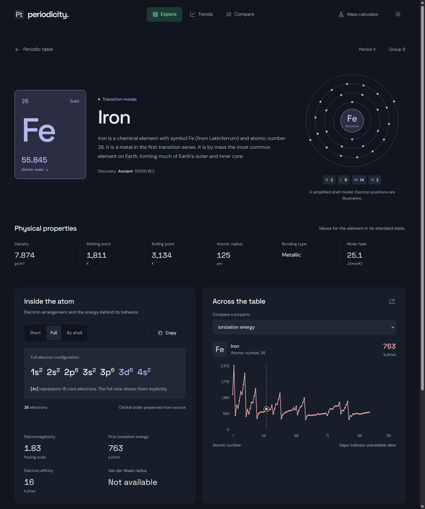

### Compare elements

Select up to four elements directly on the comparison page’s periodic table, then inspect their atomic structure and physical and chemical properties side by side. Full electron configurations highlight orbitals whose occupancies differ; the example compares **carbon, silicon, germanium, and tin** from group 14.

Click a selected tile again or its label to remove it, or use **Clear all** to start over. Arrow keys move between tiles, and Enter or Space selects them. Small screens offer a grid and a horizontally scrollable full table, and selections are saved in the page’s URL for sharing.

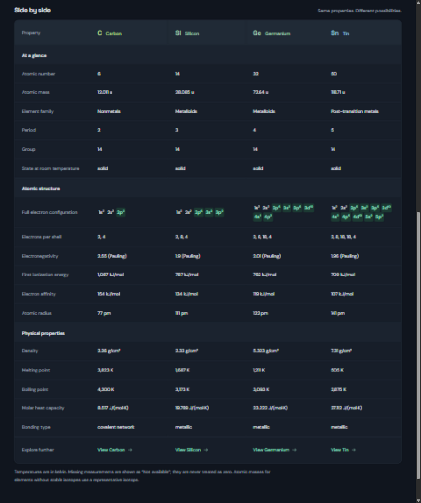

### Molar mass calculator

Enter a chemical formula to calculate its molar mass, atom counts, each element’s contribution, and mass percentages. Formulas such as `H2O`, `C6H12O6`, `Ca(OH)2`, and `K4[Fe(CN)6]` support nested parentheses and brackets, pasted subscripts, and middle-dot hydrates.

The example calculates **copper sulfate pentahydrate**, `CuSO4·5H2O`, at **249.682 g/mol**, with a breakdown of all four elements. Use the built-in examples to try another formula, or share a calculated formula through the page’s URL.

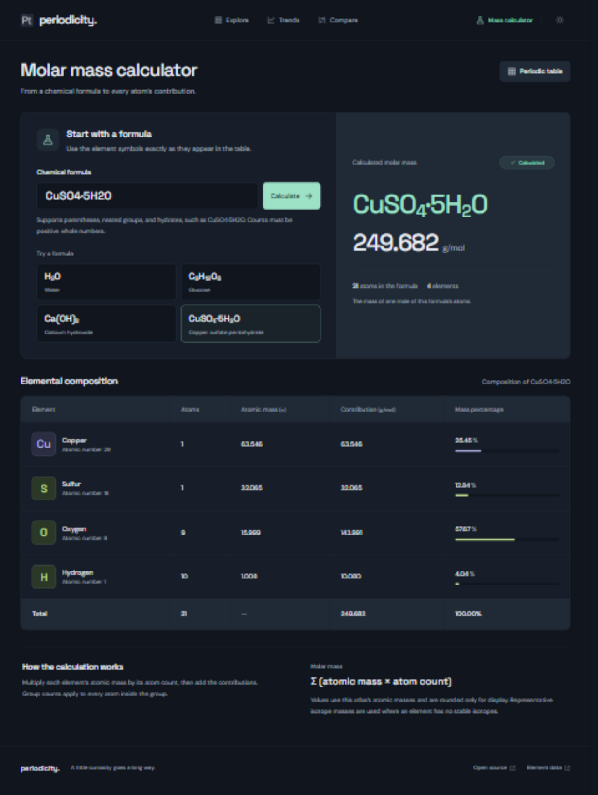

### Mobile layout, appearance, and accessibility

On small screens, the default element grid remains readable and element previews size to their content. The Table control shows the complete 18-group layout in a labeled scroll region. Selecting an element locks its preview; select it again to open its detail page. Family filtering remains available above the grid.

<details>
<summary>Mobile preview</summary>

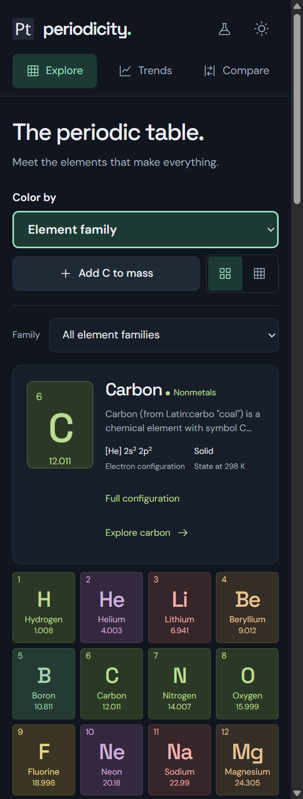

</details>

Use arrow keys to move around the desktop periodic table or mobile grid, and Enter or Space to select. All controls have visible focus indicators. Both appearances are paired independently, respect reduced motion, and remember the selected appearance when browser storage is available.

<details>
<summary>Light appearance</summary>

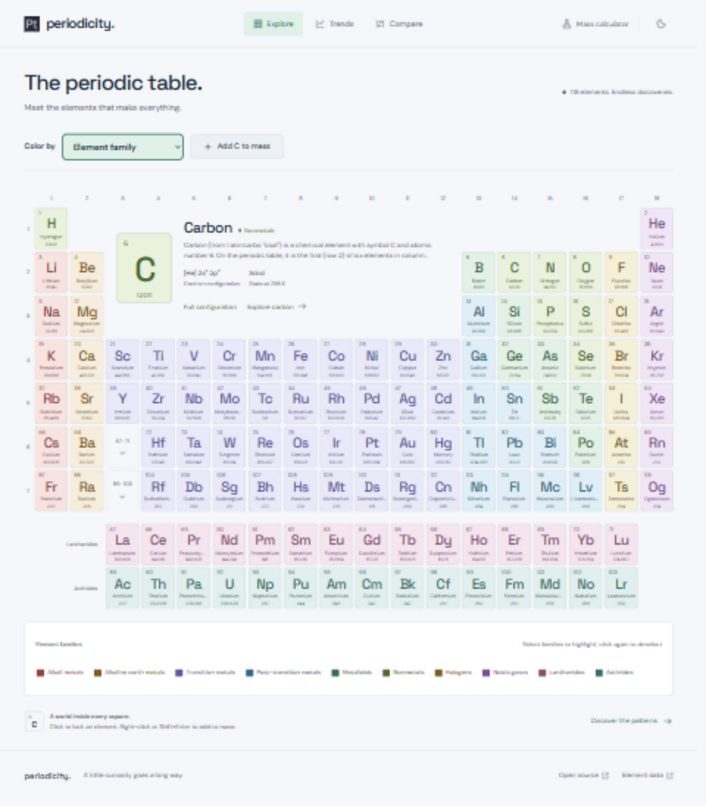

</details>

## Deployment

`bun run build` writes a fully prerendered static site to `build/`. Serve that directory with a static host that supports directory index files. Every element has its own HTML page at `/element/1/` through `/element/118/`, preserving the original numeric routes.

The static adapter also emits `404.html`. Configure your host to serve it for unknown paths. Do not deploy the source tree or Vite development server as the production site.

## Project structure

```text
src/routes/                 Explorer, trends, comparison, calculator, and element routes
src/lib/components/         Shared table layout, element buttons, viewers, and charts
src/lib/data/               Generated runtime data, original records, metadata, and provenance
src/lib/chemistry/          Formula and electron-configuration logic with unit tests
src/lib/ui/                 Shared keyboard navigation and unit tests
src/lib/view-state.ts       Shared route defaults and URL parameter parsing
scripts/                    Reference-data generation
e2e/                        Playwright browser regressions
src/app.css                 Paired theme tokens, fonts, and shared controls
design-system/periodicity/  Design decisions and interaction principles
```

Svelte 5 runes drive the interface. SvelteKit 3 uses package subpath imports (`#lib/*`) and its current configuration in `vite.config.ts`. Shared route parsers also drive the pre-hydration bootstrap. URL state uses the effective shallow-navigation URL so repeated interactions preserve selections, display modes, temperature, and filters.

The explorer and comparison picker share `PeriodicTable.svelte`, `ElementButton.svelte`, layout controls, and keyboard navigation. The explorer mounts one set of 118 tiles and one preview; CSS adapts that same tree for the desktop table, mobile grid, and mobile table. Bun unit tests live beside the modules they protect; browser tests live in `e2e/`.

## Reference data

This rewrite preserves the original project's 118-element dataset and its curated property corrections. The original general records came from [Periodic-Table-JSON](https://github.com/Bowserinator/Periodic-Table-JSON); numeric properties came from `periodic-table@0.0.8`. Both are vendored as reference data. See [provenance and units](src/lib/data/PROVENANCE.md) and the [upstream data license](src/lib/data/periodic-table-LICENSE.txt).

`scripts/generate-elements.ts` normalizes those records into the committed `elements.generated.json`, containing the properties used by the application. The browser reads this prepared dataset directly. Development and production builds check its freshness; after changing reference records or normalization, regenerate and commit the result:

```sh
bun run data:generate
bun run data:check
```

Values are historical reference measurements, with some representative isotope mass numbers for unstable elements. Unknown properties remain unavailable. The displayed atomic radius is the source's covalent radius; electron affinity uses the energy-released convention, converted from the legacy electron-attachment enthalpy signs. The shell model shows electron counts, with illustrative positions.

## License

[MIT](LICENSE). Original project by Kadin Zhang and contributors.
